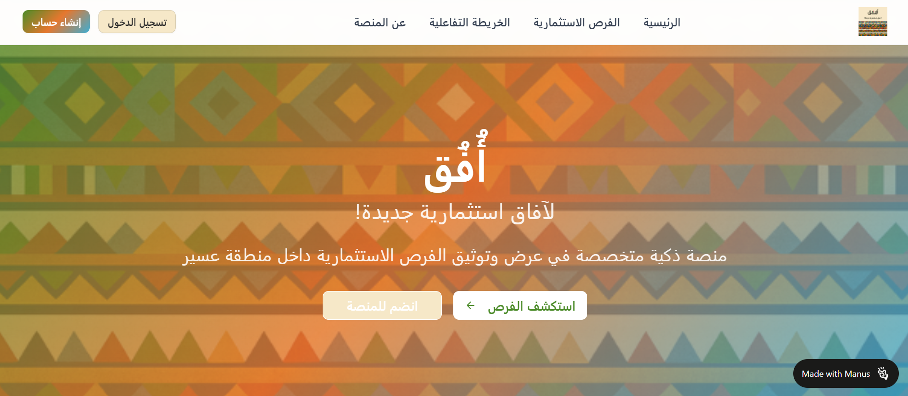

# Afaq | Investment Opportunities Platform

Afaq (أُفُق) is a digital platform developed for the Asir Hackathon to support local investment by showcasing investment opportunities, improving access to investment information, and encouraging community participation in the Asir region.

## Project Preview



*The homepage of Afaq, featuring the platform's interface and its main navigation options.*

## Live Demo

Explore the deployed platform:

**[Visit Afaq](https://3dhkilcjoyo0.manus.space)**

The live demo provides access to the published version of the platform. Its functionality may differ from the source code available in this repository.

## Project Overview

Afaq aims to provide a digital space for presenting and documenting investment opportunities in the Asir region. The platform focuses on improving access to investment information, supporting idea owners, protecting intellectual property, and encouraging community engagement in evaluating and developing investment opportunities.

The project was developed as part of the Asir Hackathon, with the goal of supporting local investment initiatives and contributing to Saudi Vision 2030.

## Key Features

- **Investment Opportunities:** Browse investment opportunities and explore their details.
- **AI Recommendations:** An AI-based recommendation module for investment opportunities.
- **Interactive Maps:** Map-related features for exploring investment opportunities geographically.
- **User Authentication:** User registration, login, and account management.
- **Community Voting:** A voting system that supports community participation.
- **Intellectual Property Protection:** Interface components related to intellectual property protection and NDA acceptance.

## Technologies Used

### Frontend
- React and JSX
- CSS
- HTML

### Backend
- Python
- Flask
- Flask-CORS
- Flask-SQLAlchemy

### Database
- SQLite

## Project Structure

The repository contains frontend and backend components, including the following files:

```text
Afaq/
├── Backend/
│   ├── ai_recommendations.py
│   ├── auth.py
│   ├── main.py
│   ├── opportunity.py
│   └── user.py
├── frontend/
│   ├── App.jsx
│   ├── App.css
│   ├── Header.jsx
│   ├── Footer.jsx
│   ├── Home.jsx
│   ├── OpportunitiesPage.jsx
│   ├── OpportunityDetails.jsx
│   ├── InteractiveMap.jsx
│   ├── MapPage.jsx
│   ├── VotingSystem.jsx
│   └── index.html
├── afaq-homepage.png
└── README.md
```

*Note: This is a simplified overview of selected project files. The repository may contain additional files and modules.*

## Project Objectives

- Improve access to local investment opportunities.
- Support the presentation and documentation of investment information.
- Encourage community participation in evaluating investment opportunities.
- Support intellectual property protection.
- Promote local investment initiatives aligned with Saudi Vision 2030.

## Project Information

- **Project Name:** Afaq (أُفُق)
- **Event:** Asir Hackathon
- **Category:** Investment Technology
- **Primary Technologies:** React, Python, and Flask
- **Deployment Platform:** Manus

## Disclaimer

Afaq was developed as a hackathon project to demonstrate a digital approach to presenting investment opportunities. The availability of features and the accuracy of displayed information depend on the deployed implementation and the data provided by the platform.

